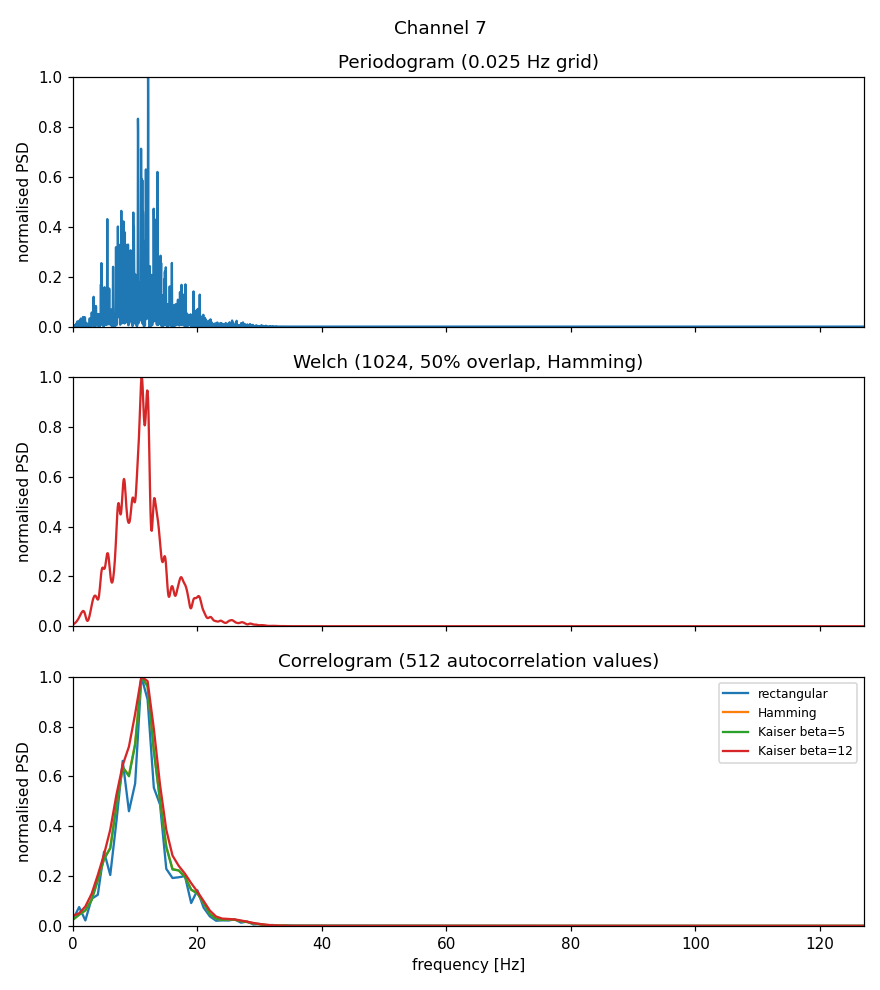
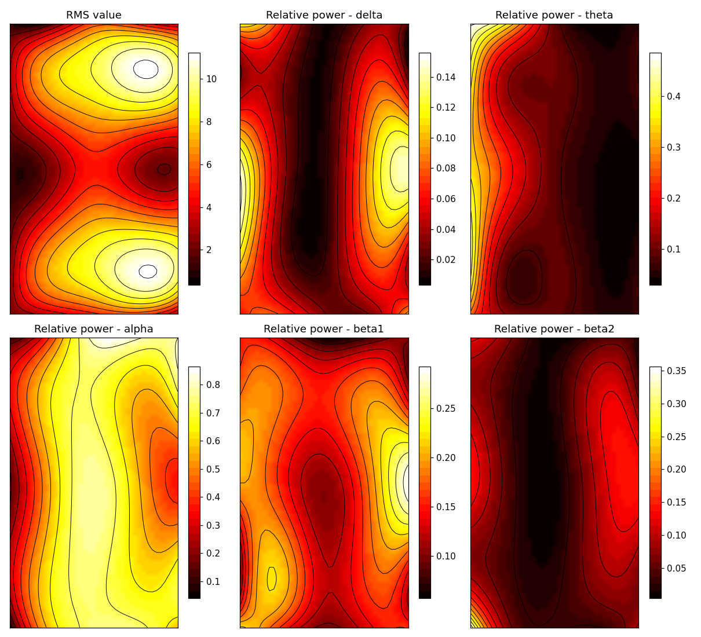

# EEG spectral analysis: periodogram, Welch and correlogram

Non-parametric power spectral density (PSD) estimation applied to a 25-channel
EEG recording (relaxed subject, eyes closed), with the distribution of power
over the classic EEG rhythms and colour-coded scalp maps.

This is a Python port of the fourth laboratory of the *Biomedical Signal
Processing* course (originally written in MATLAB).



## What it does

For the channels of interest (default: 7 and 9):

1. plots one second of the signal in the time domain;
2. estimates the PSD with three classic methods and compares them:
   - **periodogram** (rectangular window on the whole record, zero-padded to a
     0.025 Hz frequency grid);
   - **Welch's method** (1024-sample segments, 50 % overlap, Hamming window);
   - **correlogram** (Blackman-Tukey, 512 autocorrelation values, with
     rectangular, Hamming, Kaiser (beta = 5) and Kaiser (beta = 12) windows);
3. computes the fraction of the total power in each band:

| Rhythm | Band (Hz) |
|--------|-----------|
| delta  | 0.5 - 3.5 |
| theta  | 3.5 - 7   |
| alpha  | 7 - 14    |
| beta1  | 14 - 21   |
| beta2  | 21 - 30   |

Then, using all 25 channels, it draws interpolated scalp maps of the RMS value
and of the relative power of each rhythm.



## Project structure

```
eeg_spectral/      library: loader, PSD estimators, band powers, scalp maps
run_lab4.py        command-line script that reproduces the whole analysis
tests/             unit tests on synthetic signals
data/              put EEG2501.BIN here (not versioned)
docs/example_output/   figures and CSV produced by the script
```

## Installation

```bash
git clone <your-repo-url>
cd <repo-folder>
python -m venv .venv
source .venv/bin/activate        # Windows: .venv\Scripts\activate
pip install -r requirements.txt
```

## Usage

```bash
python run_lab4.py --data data/EEG2501.BIN --out results
```

Options: `--channels 7 9` (1-based channels analysed in detail), `--start 10`
(start in seconds of the time-domain excerpt), `--show` (also open the
figures). The script writes the PNG figures and `band_powers.csv` to the output
folder and prints the band powers to the console.

Using the library directly:

```python
from eeg_spectral import load_eeg_bin, welch_psd, band_powers

eeg = load_eeg_bin("data/EEG2501.BIN")          # shape (7680, 25)
f, pxx = welch_psd(eeg[:, 6], fs=512)           # channel 7
print(band_powers(f, pxx))
```

## Example result (channel 7, fraction of total power)

| Method                       | delta  | theta  | alpha  | beta1  | beta2  |
|------------------------------|--------|--------|--------|--------|--------|
| Periodogram (0.025 Hz grid)  | 0.0252 | 0.1101 | 0.6519 | 0.1827 | 0.0277 |
| Welch (1024, 50 %, Hamming)  | 0.0254 | 0.1155 | 0.6561 | 0.1733 | 0.0274 |
| Correlogram (rectangular)    | 0.0283 | 0.0861 | 0.6288 | 0.2111 | 0.0326 |
| Correlogram (Hamming)        | 0.0259 | 0.0935 | 0.6266 | 0.2134 | 0.0353 |
| Correlogram (Kaiser beta=5)  | 0.0258 | 0.0935 | 0.6270 | 0.2134 | 0.0353 |
| Correlogram (Kaiser beta=12) | 0.0284 | 0.0971 | 0.6106 | 0.2206 | 0.0367 |

The alpha rhythm dominates, as expected for a relaxed subject with eyes
closed. The methods agree on the overall picture; the correlogram has the
smoothest spectrum (lowest variance) but the coarsest resolution (1 Hz), so
its band fractions differ slightly from the other two. Full results for both
channels are in `docs/example_output/band_powers.csv`.

## Implementation notes

- **Band edges** are half-open intervals (`lo <= f < hi`), so no frequency bin
  is counted in two bands and the edges need not coincide with grid points.
- **Total power** is the sum over the whole spectrum (0 to fs/2); the band
  fractions therefore add up to less than 1.
- **Correlogram**: unbiased autocorrelation, lags -255 ... 256 (512 values),
  magnitude of the FFT (arbitrary units; frequency step 1 Hz).
- **Scalp maps** use the relative power from a single rectangular-window
  periodogram of the first 4096 samples (8 s) of each channel. The 25 channels
  are arranged on a 5x5 grid row by row (channels 1-5 form the first row);
  adapt `to_grid` in `eeg_spectral/maps.py` if your electrode layout differs.
  The grid is interpolated with a cubic spline.
- The standard deviation uses N-1 normalisation (as MATLAB's `std`).

## Tests

```bash
python -m unittest -v
```

The tests use synthetic signals (sinusoids, white noise) to check, for
example, that the periodogram satisfies Parseval's theorem, that all methods
locate a 10 Hz sinusoid, that white noise power is proportional to the band
width, and that the file layout and the map interpolation are correct. The
results have not been compared numerically against the original MATLAB output.

## Data

The recording is not included in the repository. See `data/README.md` for the
expected format.
